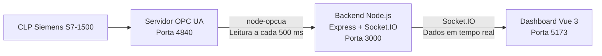

# Interface CLP // Centro de Triagem


Dashboard técnico para monitoramento em tempo real de uma linha automatizada de separação de peças por cor. A interface apresenta contadores circulares, distribuição da produção e estado da comunicação com um CLP Siemens S7-1500.

> Projeto acadêmico desenvolvido na Faculdade de Tecnologia Senai Roberto Mange — Campinas, SP.

---

## Visão geral

O sistema foi criado para acompanhar uma automação industrial baseada em:

- triagem de peças verdes, amarelas e vermelhas;
- leitura de variáveis de contagem do CLP;
- comunicação OPC UA;
- atualização dos dados pela rede em tempo real;
- visualização em um painel web moderno com tema escuro.



---

## Interface

- Tema escuro com identidade técnica
- Painel lateral de navegação
- Indicadores visuais de conexão OPC UA
- Contadores circulares por cor
- Percentual de participação de cada classificação
- Resumo da distribuição total da produção
- Layout responsivo para desktop e dispositivos menores

---

## Tecnologias

| Camada | Tecnologias |
| --- | --- |
| Interface | Vue 3, Vite, JavaScript, CSS |
| Comunicação web | Socket.IO Client |
| Backend | Node.js, Express, CORS |
| Automação | node-opcua |
| CLP | Siemens S7-1500 |
| Protocolo industrial | OPC UA |

---

## Arquitetura do projeto

```text
interface_grafica_AUI/
├── backend/
│   ├── package-lock.json
│   ├── package.json
│   └── server.js
├── src/
│   ├── App.vue
│   ├── main.js
│   └── styles.css
├── .vscode/
│   └── extensions.json
├── index.html
├── jsconfig.json
├── package-lock.json
├── package.json
├── vite.config.js
└── README.md
```

---

## Pré-requisitos

- Node.js `^22.18.0` ou `>=24.12.0`
- npm
- CLP Siemens S7-1500 em modo `RUN`, ou PLCSIM Advanced
- Servidor OPC UA ativo no TIA Portal
- Segurança OPC UA configurada conforme o ambiente do projeto

---

## Configuração OPC UA

Os parâmetros de conexão ficam no arquivo [`backend/server.js`](backend/server.js).

| Parâmetro | Valor atual |
| --- | --- |
| Endpoint | `opc.tcp://169.254.171.199:4840` |
| Namespace URI | `http://vue` |
| Security mode | `None` |
| Security policy | `None` |

### Mapeamento das variáveis

| Classificação | Variável no TIA Portal | Node ID | Campo no frontend |
| --- | --- | --- | --- |
| Vermelho | `contPecasVermelhas` | `i=3` | `contPecasVermelhas` |
| Verde | `contPecasVerdes` | `i=4` | `contPecasVerdes` |
| Amarelo | `contPecasAmarelas` | `i=5` | `contPecasAmarelas` |
| Total | `contPecasTotal` | `i=6` | `contPecasTotal` |

Caso o endereço, namespace ou os IDs sejam alterados, atualize as constantes `ENDPOINT`, `URI_NAMESPACE` e `IDS` em `backend/server.js`.

---

## Como executar

### 1. Instalar as dependências do frontend

Na pasta raiz do projeto:

```powershell
npm install
```

### 2. Instalar as dependências do backend

```powershell
cd backend
npm install
cd ..
```

### 3. Verificar a comunicação com o CLP

```powershell
Test-NetConnection -ComputerName 169.254.171.199 -Port 4840
```

O valor `TcpTestSucceeded` deve ser `True`.

### 4. Iniciar o backend

Em um terminal:

```powershell
cd backend
node server.js
```

O servidor será iniciado em:

```text
http://localhost:3000
```

### 5. Iniciar o frontend

Em outro terminal, na pasta raiz:

```powershell
npm run dev
```

Acesse o endereço informado pelo Vite, normalmente:

```text
http://localhost:5173
```

---

## Endpoints e dados

### Verificação do backend

```text
GET http://localhost:3000
```

Exemplo de resposta:

```json
{
  "backend": "Funcionando",
  "opcUa": "Conectado",
  "producao": {
    "contPecasVermelhas": 0,
    "contPecasVerdes": 0,
    "contPecasAmarelas": 0,
    "contPecasTotal": 0
  }
}
```

### Eventos Socket.IO

| Evento | Finalidade |
| --- | --- |
| `opcStatus` | Estado da conexão OPC UA |
| `dadosProducao` | Contadores atualizados da linha |

---

## Build de produção

Gerar o frontend otimizado:

```powershell
npm run build
```

Visualizar localmente o build gerado:

```powershell
npm run preview
```

---

## Solução de problemas

### Porta 3000 ocupada

```text
EADDRINUSE
```

Finalize a instância anterior de `server.js` e inicie o backend novamente.

### CLP desconectado

- confirme que o CLP ou PLCSIM está em modo `RUN`;
- valide o endereço configurado em `ENDPOINT`;
- confirme que o servidor OPC UA está ativo no TIA Portal;
- confirme que o computador e o CLP estão na mesma rede;
- valide a configuração de segurança OPC UA.

### Namespace não encontrado

Verifique se a URI `http://vue` está registrada no projeto OPC UA do TIA Portal. Caso seja diferente, atualize `URI_NAMESPACE`.

---

## Autor

Natan Barboza Andrade

**Instituição:** Faculdade de Tecnologia Senai Roberto Mange — Campinas, SP

teste